# TP 6 – Service Banque en CORBA

**Matière :** Développement d'applications réparties  
**Niveau :** LSI 3  
**Établissement :** Faculté des Sciences de Sfax – Département d'informatique et des communications  
**Année universitaire :** 2026–2027  
**Réalisé par :** Fatma Mhadhbi

---

## 🎯 1. Objectif du TP

L'objectif de ce TP est de développer une application répartie Client-Serveur en Java en utilisant le middleware **CORBA**.

L'application permet de gérer des comptes bancaires à distance à travers les opérations suivantes :

- Créer un compte avec un solde initial.
- Effectuer un versement sur un compte.
- Effectuer un retrait.
- Consulter un compte par son code.
- Consulter la liste de tous les comptes.
- Convertir un montant en Euro vers le Dinar Tunisien.

---

## 🧰 2. Environnement de travail

| Outil | Version / Technologie |
|---|---|
| Langage | Java |
| JDK | Eclipse Temurin 1.8.0_504 |
| IDE | IntelliJ IDEA |
| Gestion de projet | Maven |
| Middleware | CORBA |
| Interface | IDL |
| Annuaire | JNDI / tnameserv |
| Gestion de versions | Git / GitHub |

### 2.1 Configuration du JDK

Le JDK 8 a été installé à partir d'IntelliJ IDEA.

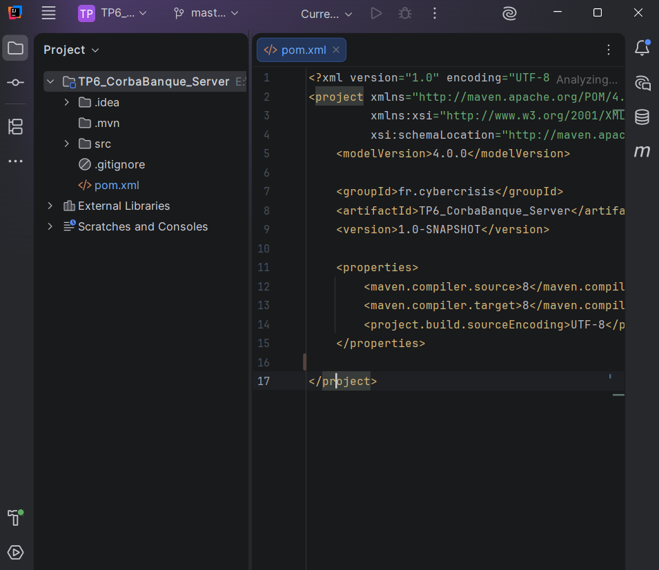

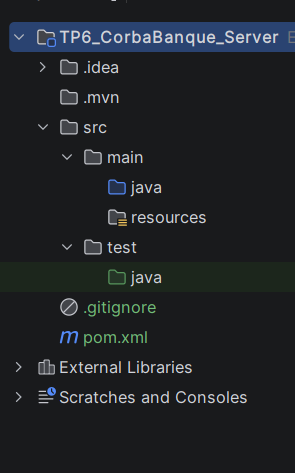

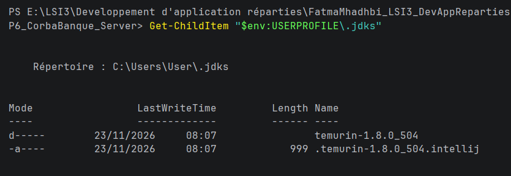

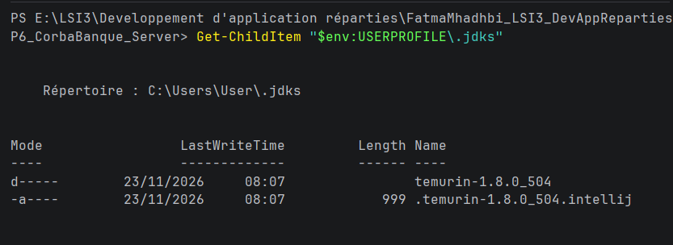

### 2.2 Vérification des outils CORBA

Vérification de la présence du compilateur IDL `idlj` et du service de nommage `tnameserv`.

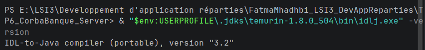

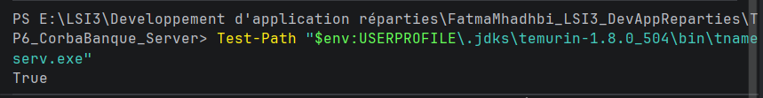

### 2.3 Configuration des variables d'environnement

Configuration de `JAVA_HOME` et de `PATH` pour utiliser le JDK 8 depuis le terminal.

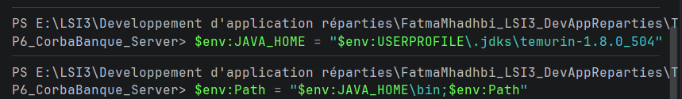

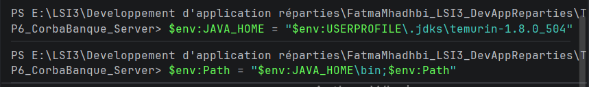

Vérification des versions de Java et de IDL.

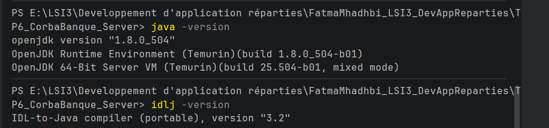

---

## 🖥️ 3. Développement du serveur CORBA

### 3.1 Création du projet

Création du projet Maven `TP6_CorbaBanque_Server` avec JDK 8.

### 3.2 Définition de l'interface IDL

Le fichier `Banque.idl` définit le contrat de communication entre le client et le serveur.

Il contient la structure `Compte`, le type `tabComptes` et l'interface distante `IBanqueRemote`.

### 3.3 Compilation du fichier IDL

La commande utilisée dans le dossier `src/main/java` :

```bash
idlj -fall -v Banque.idl
```

Cette compilation génère automatiquement le package `corbaBanque` contenant les classes nécessaires à la communication CORBA.

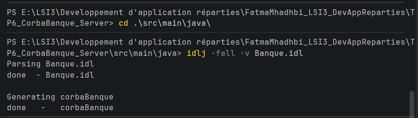

### 3.4 Implémentation du servant

La classe `BanqueImpl` appartient au package `service`.

Elle hérite de `IBanqueRemotePOA` et implémente les opérations bancaires définies dans l'interface IDL.

### 3.5 Configuration JNDI

Le fichier `jndi.properties` est placé dans `src/main/resources`.

Il contient les paramètres de connexion à l'annuaire CORBA :

```properties
java.naming.factory.initial = com.sun.jndi.cosnaming.CNCtxFactory
java.naming.provider.url = iiop://localhost:900
```

### 3.6 Démarrage du serveur

La classe `BanqueServer` initialise l'ORB, active le RootPOA, crée le servant et enregistre sa référence dans l'annuaire sous le nom `banque`.

---

## 💻 4. Développement du client CORBA

Création du projet Maven `TP6_CorbaBanque_Client`.

Le fichier `Banque.idl` est également utilisé côté client afin de générer le package `corbaBanque`.

### 4.1 Compilation IDL côté client

La commande utilisée :

```bash
idlj -fall -v Banque.idl
```

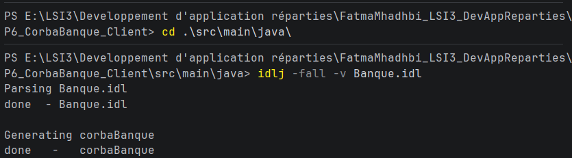

### 4.2 Implémentation du client

La classe `BanqueClient`, dans le package `corbaClient`, permet de :

- Se connecter à l'annuaire JNDI.
- Rechercher la référence distante `banque` avec `lookup`.
- Obtenir le stub avec `IBanqueRemoteHelper.narrow()`.
- Appeler les méthodes distantes du service bancaire.

---

## ▶️ 5. Exécution de l'application

L'ordre de lancement est le suivant :

1. Démarrer le service de nommage.
2. Démarrer le serveur CORBA.
3. Exécuter le client CORBA.

### 5.1 Lancement du service de nommage

Commande utilisée :

```bash
tnameserv -ORBInitialPort 900
```

Le message `Prêt.` confirme le démarrage du service de nommage.

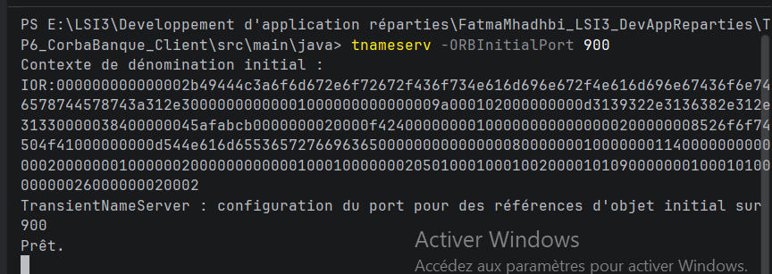

### 5.2 Lancement du serveur

Le serveur démarre et enregistre l'objet distant `banque` dans l'annuaire.

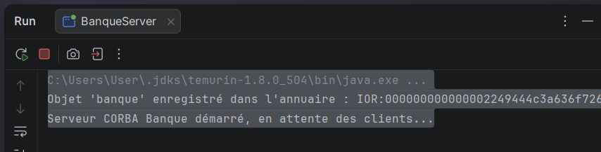

### 5.3 Lancement du client

Le client appelle les différentes méthodes distantes du serveur.

Résultats obtenus :

| Opération | Résultat |
|---|---|
| Création du compte | Compte créé. |
| Versement de 200 | Versement effectué. |
| Retrait de 100 | Retrait effectué. |
| Consultation | Solde = 1100.0 |
| Liste des comptes | Code : 1, Solde : 1100.0 |
| Conversion de 100 € | 335.0 DT |

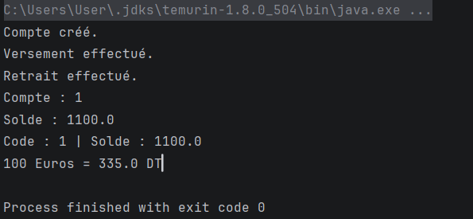

Toutes les opérations ont été exécutées avec succès. Le programme client s'est terminé avec le code de sortie `0`.

---

## 📁 6. Structure du dépôt GitHub

```text
TP6_Corba/
│
├── TP6_CorbaBanque_Server/
│   ├── pom.xml
│   └── src/
│       └── main/
│           ├── java/
│           │   ├── Banque.idl
│           │   ├── corbaBanque/
│           │   ├── service/
│           │   │   └── BanqueImpl.java
│           │   └── corbaServer/
│           │       └── BanqueServer.java
│           └── resources/
│               └── jndi.properties
│
├── TP6_CorbaBanque_Client/
│   ├── pom.xml
│   └── src/
│       └── main/
│           ├── java/
│           │   ├── Banque.idl
│           │   ├── corbaBanque/
│           │   └── corbaClient/
│           │       └── BanqueClient.java
│           └── resources/
│               └── jndi.properties
│
├── 01_pom_xml.png
├── 02_structure_projet.png
├── ...
├── 14_client_resultat.png
│
├── .gitignore
└── README.md
```

---

## 📤 7. Dépôt GitHub

Les deux projets Client et Serveur ainsi que les captures d'écran sont déposés dans un seul dépôt GitHub :

**GitHub :** [TP6_Corba](https://github.com/FatmaMhdhbi/TP6_Corba)

---

## ✅ 8. Conclusion

Ce TP m'a permis de mettre en pratique la communication entre applications réparties avec CORBA.

J'ai appris à définir une interface avec IDL, générer les classes Java avec `idlj`, développer un serveur CORBA, enregistrer un objet distant dans un annuaire et appeler ses méthodes depuis un client.

Les tests réalisés montrent que les différentes opérations bancaires fonctionnent correctement.
